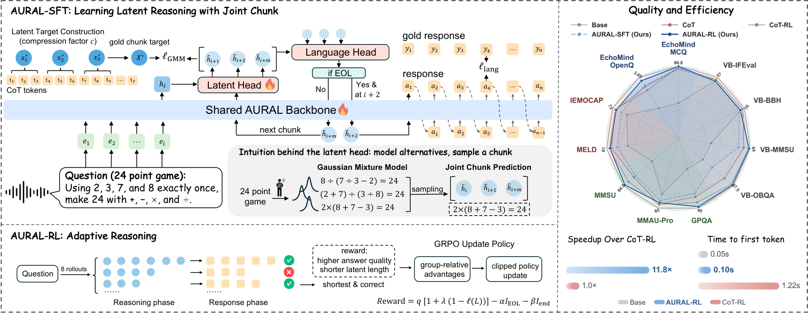

<h1 align="center">AURAL</h1>

<p align="center">
  <strong>Adaptive Latent Reasoning with Joint Chunk<br>for Speech Language Models</strong>
</p>

<p align="center">
  <a href="https://arxiv.org/abs/2610.01560"></a>
  <a href="https://huggingface.co/YuxiangW/AURAL"></a>
  <a href="https://huggingface.co/datasets/YuxiangW/AuralReason"></a>
</p>

<p align="center">
  <strong>English</strong> · <a href="README_zh.md">简体中文</a>
</p>

<p align="center">
  <a href="#installation">Installation</a> · <a href="#inference">Inference</a> · <a href="#auralreason">AuralReason</a> · <a href="#training">Training</a>
</p>

AURAL reasons in continuous latent space and then generates a text answer. AURAL-SFT learns a distribution over future latent chunks from concise chain-of-thought supervision. AURAL-RL improves answer quality and learns when to stop reasoning through a quality-weighted conciseness reward.

<p align="center">
  <a href="assets/overview.png"></a>
</p>

The released **AURAL-RL** checkpoint uses **Qwen2.5-Omni-7B**, compression factor **c = 4**, chunk size **m = 10**, four Gaussian components, and a covariance rank of 16.

## Installation

Use Linux, Python 3.12, and an NVIDIA GPU. Training uses BF16 and DeepSpeed ZeRO-2; the inference examples use a single GPU.

```bash
git clone https://github.com/AmphionTeam/AURAL.git
cd AURAL
python3.12 -m venv .venv
source .venv/bin/activate
python -m pip install -e '.[train]'
python -m pip install flash-attn==2.8.3 --no-build-isolation
```

The package specifies compatible dependency versions. A CUDA toolkit is needed to build FlashAttention. Use `--attn-impl sdpa` to run with PyTorch's attention implementation.

## Inference

The model downloads automatically on first use:

```bash
python -m aural.infer --audio speech.wav
```

Add an instruction to ask a specific question about the audio:

```bash
python -m aural.infer \
  --audio speech.wav \
  --text "Describe the emotion in the speaker's voice."
```

Text input works through the same interface:

```bash
python -m aural.infer --text "What is 17 + 25?"
```

Use `--model /path/to/checkpoint` for a local model, `--device cuda:1` to select a GPU, and `--json` to include the number of latent steps and termination status. Default decoding samples latent chunks and EOL decisions at temperature 1, allows up to 100 latent states, and generates the answer greedily.

In Python:

```python
from aural.inference import load_generator

model = load_generator("YuxiangW/AURAL")
result = model.generate(
    [{"role": "user", "content": "<audio>\nDescribe the speaker's emotion."}],
    audios=["speech.wav"],
)
print(result.answer)
```

## AuralReason

The public dataset contains the complete filtered, newly constructed CoT examples from three sources:

| Configuration | Examples | Language | Task |
|---|---:|---|---|
| `LIME` | 314,855 | Chinese, English | Voice-sensitive dialogue |
| `EmotionCoT` | 17,840 | English | Speech emotion recognition |
| `HumanSpeech` | 74,330 | Chinese, English | Voice-sensitive dialogue |
| **Total** | **407,025** | | |

Each configuration has a `train` split. EmotionCoT uses IEMOCAP Sessions 1–4 and MELD train/dev. Audio is embedded in Parquet as 16 kHz mono FLAC.

| Column | Content |
|---|---|
| `id` | Stable sample identifier |
| `audio` | Audio bytes and a public filename |
| `instruction` | Task instruction; empty for audio-only dialogue |
| `transcript` | Spoken content |
| `reasoning` | Concise CoT supervision |
| `response` | Assistant response or emotion label |
| `language` | `zh` or `en` |
| `source` | Original speech corpus |

Read a sample without an additional audio decoding dependency:

```python
import io
import soundfile as sf
from datasets import Audio, load_dataset

data = load_dataset("YuxiangW/AuralReason", "EmotionCoT", split="train")
data = data.cast_column("audio", Audio(decode=False))
sample = data[0]
waveform, sample_rate = sf.read(io.BytesIO(sample["audio"]["bytes"]))
print(sample["reasoning"])
print(sample["response"])
```

Prepare all three configurations for training:

```bash
python -m aural.prepare_data --output data/auralreason
```

Use `--configs EmotionCoT` to select a source, or `--limit 32` for a small local subset. The command writes `train.jsonl` and its audio files.

## Training

The training sequence is **CoT initialization → AURAL-SFT → AURAL-RL**. Each stage accepts local JSONL and writes loadable checkpoints. Replace `N` below with the saved checkpoint step printed by training.

### 1. CoT initialization

```bash
torchrun --standalone --nproc_per_node=8 -m aural.train_cot \
  --model Qwen/Qwen2.5-Omni-7B \
  --data data/auralreason/train.jsonl \
  --output outputs/cot
```

### 2. AURAL-SFT

```bash
torchrun --standalone --nproc_per_node=8 -m aural.train_sft \
  --model outputs/cot/checkpoint-N \
  --data data/auralreason/train.jsonl \
  --output outputs/sft
```

SFT pools every `c` CoT embeddings into a latent target, predicts a low-rank Gaussian mixture over `m` future states, and combines joint likelihood with chunkwise semantic alignment (CSA). Latent scheduled sampling (LSS) feeds sampled chunks into a second pass, with its loss weight increasing over 500 updates.

### 3. AURAL-RL

Prepare your RL prompts as JSONL. An objective example is:

```json
{"instruction":"What is 17 + 25? Reply with just the number.","reference":"42","reward":"exact"}
```

Include `audio` for a spoken prompt. Then train from your SFT checkpoint:

```bash
torchrun --standalone --nproc_per_node=8 -m aural.train_rl \
  --model outputs/sft/checkpoint-N \
  --data data/rl.jsonl \
  --output outputs/rl
```

RL samples eight rollouts per prompt and updates the latent chunks, EOL decisions, and answer tokens. Its reward combines answer quality with a quality-weighted bonus for shorter reasoning. Prompts with both low- and high-quality candidates contribute group-relative updates.

### Your own SFT data

Use one JSON object per line:

```json
{"audio":"audio/example.flac","instruction":"Describe the emotion in the voice.","reasoning":"A fast tempo and rising pitch suggest excitement.","response":"The speaker sounds excited."}
```

`audio` paths are relative to the JSONL file or absolute. For audio-only dialogue, leave `instruction` empty. For text tasks, omit `audio` and put the question in `instruction`. `reasoning` and `response` are required. The trainer inserts the reasoning delimiters and audio markers automatically.

### Custom rewards

RL supports `exact`, `text_judge`, `audio_judge`, and a Python `module:function`. A custom function receives a sample and its candidate answers and returns one quality score in `[0, 1]` per answer. For example, save this as `my_reward.py` in an importable directory:

```python
def score(sample, answers):
    expected = sample["reference"].strip().casefold()
    scores = []
    for answer in answers:
        answer = answer.strip().removeprefix("Answer:").strip().casefold()
        scores.append(float(answer == expected))
    return scores
```

Set `"reward": "my_reward:score"` in each row, or pass `--reward my_reward:score` as the default. An optional `metadata` object carries task-specific information to the function.

For an API judge, configure an OpenAI-compatible chat-completions endpoint through environment variables:

| Reward | Environment variables |
|---|---|
| `text_judge` | `AURAL_TEXT_JUDGE_URL`, `AURAL_TEXT_JUDGE_MODEL`, `AURAL_TEXT_JUDGE_API_KEY` |
| `audio_judge` | `AURAL_AUDIO_JUDGE_URL`, `AURAL_AUDIO_JUDGE_MODEL`, `AURAL_AUDIO_JUDGE_API_KEY` |

`URL` is the full chat-completions URL. Audio endpoints must accept `input_audio` with base64 WAV or FLAC. Provide a reference response in `reference`, or leave it empty for open-ended scoring.

### Training options

| Option | CoT / SFT default | RL default |
|---|---|---|
| `--epochs` | 1 | 2 |
| `--batch-size` | 4 | 1 prompt |
| `--gradient-accumulation` | 1 | 1 |
| `--learning-rate` | `1e-5` | `1e-6` |
| `--head-learning-rate` | SFT: `1e-4` | `1e-5` |
| `--max-length` | 4096 | 4096 |
| `--compression-factor` | 4 | Read from checkpoint |
| `--chunk-size` | 10 | Read from checkpoint |

Training updates the language model, audio encoder, aligners, and latent head; the vision tower stays frozen. Use `--freeze-audio-encoder` to freeze the audio encoder. Adjust `--batch-size` and `--gradient-accumulation` for your GPU memory. `--max-steps` runs a shorter job, and `--save-steps` controls checkpoint frequency.

Resume with the original data and a saved checkpoint:

```bash
torchrun --standalone --nproc_per_node=8 -m aural.train_sft \
  --model outputs/sft/checkpoint-N \
  --resume outputs/sft/checkpoint-N \
  --data data/auralreason/train.jsonl \
  --output outputs/sft
```

The same `--resume` option works for RL. For multiple nodes, use the standard `torchrun` options `--nnodes`, `--node_rank`, `--master_addr`, and `--master_port`.

## Citation

```bibtex
@article{wang2026aural,
  title={AURAL: Adaptive Latent Reasoning with Joint Chunk for Speech Language Models},
  author={Wang, Yuxiang and others},
  journal={arXiv preprint arXiv:2610.01560},
  year={2026}
}
```

## Acknowledgments

Built with [Qwen2.5-Omni](https://github.com/QwenLM/Qwen2.5-Omni), [MS-SWIFT](https://github.com/modelscope/ms-swift), and PyTorch. We thank the creators of the source speech corpora. Source information accompanies each AuralReason example.
